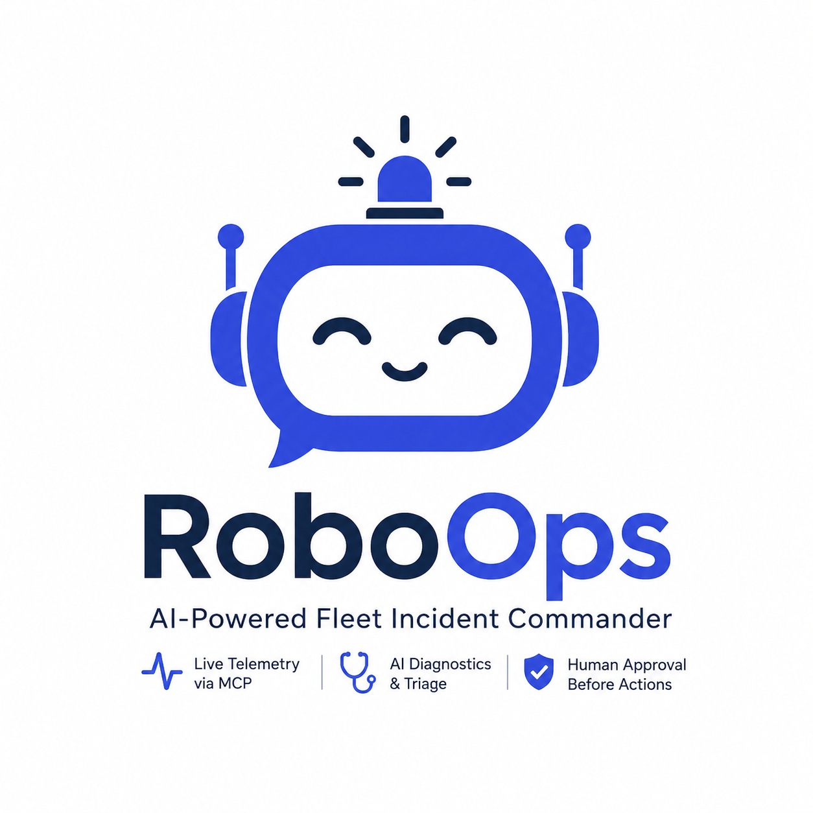

<div align="center">

<h1>RoboOps</h1>

<br>

> **Autonomous incident triage and self-healing agent for ROS 2 AMR fleets.**

<p>


</p>

</div>

## Overview

RoboOps is an AI-powered incident commander for ROS 2 Autonomous Mobile Robot (AMR) fleets. It connects to robot telemetry through MCP, applies ROS 2 triage rules, and executes recovery actions only after verified human approval. It is designed for the Drawerrr AI Safety and Control Challenge in the **physical-world actions** category.

Built on FastMCP with safety-first actuator controls, SQLite audit logging, stale-telemetry fail-closed checks, approval grants, and reproducible red-team tests.

## Key Safety Properties

- Human approval required before every actuator command.
- One-time approval grants bound to a robot and action; replayed grants are rejected.
- Navigation recovery is blocked for stale or missing telemetry.
- Battery, collision-alert, and speed invariants are enforced before recovery.
- Rate limiting protects robots from repeated recovery actions.
- Incident actions are persisted to an integrity-checked audit log.
- Incident-log paths are constrained to the project root.
- Safety logic and bypass attempts are covered by red-team tests.

## Quick Start

```bash
python -m venv .venv
.venv\Scripts\activate
pip install -r requirements.txt
python -m pytest tests/ -v
python scripts/demo_safety.py
```

For full TrueForge/Ollama setup, see [SETUP.md](SETUP.md).

## Project Structure

```text
roboops_agent/
├── mcp_server/
│   ├── robot_fleet_mcp.py    # FastMCP server with fleet tools
│   └── safety_guard.py       # Rate limiting and safety invariants
├── agent/
│   └── client.py             # Resilient LLM router
├── database/
│   └── audit_logger.py       # SQLite incident audit log
├── sandbox/
│   ├── mcap_parser.py        # MCAP/Rosbag parser
│   └── diagnose_logs.py      # Telemetry analysis
├── scripts/
│   └── demo_safety.py        # Reproducible challenge demo
├── tests/
│   └── test_mcp_server.py    # 32 tests, red-team coverage
├── docker-compose.yml        # Reproducible local runtime
├── TODO.md                   # Remaining production-readiness backlog
└── SETUP.md
```

## MCP Tools

| Tool | Description |
| --- | --- |
| `get_fleet_telemetry` | Real-time robot status, battery, error codes, and location |
| `get_incident_log_file` | Path to sensor/odometry log, constrained to project root |
| `execute_robot_action` | Recovery action requiring valid operator approval |
| `get_current_datetime` | Current UTC timestamp |
| `safety_invariant_check` | Battery, collision, speed, and telemetry-freshness status |
| `restart_planner` | NAV2 planner restart requiring explicit approval |

## Safety Guard

The safety layer enforces:

1. Human-in-the-loop approval before every actuator command.
2. Rate limiting: max 3 recovery actions per robot per 5 minutes. `abort_mission` is exempt as an emergency stop.
3. Battery check: navigation recovery blocked below 15% battery.
4. Collision avoidance: navigation recovery blocked during collision alerts.
5. Speed limit: navigation recovery blocked above 20 km/h.
6. Stale telemetry: navigation recovery blocked when telemetry is missing or older than 30 seconds.
7. Project-root containment for incident-log paths.

## Approval Modes

Legacy approval strings are accepted by default for development:

```env
ROBOOPS_ALLOW_LEGACY_APPROVALS=true
```

For production/challenge evaluation, disable legacy approvals and use an operator token or a generated grant:

```env
ROBOOPS_ALLOW_LEGACY_APPROVALS=false
ROBOOPS_OPERATOR_TOKEN=change-me-before-production
```

Approval grants created by `issue_approval()` are one-time, expire after 120 seconds, and are bound to one robot and one action.

## Audit Trail

All successful, blocked, and failed actions are logged to `roboops_audit.db`. Audit records include:

- timestamp
- robot ID
- error code
- diagnosis
- remediation action
- operator approval
- execution result
- integrity hash

Maintenance helpers are available in `database/audit_logger.py`:

- `purge_old_events(retention_days=30)`
- `backup_db(destination)`
- `verify_integrity()`

## Reproducibility

Run the safety demo:

```bash
python scripts/demo_safety.py
```

Run with Docker Compose:

```bash
docker compose up
```

## Testing

```bash
python -m pytest tests/ -v
python -m pytest tests/ --cov=mcp_server --cov=agent --cov=database --cov=sandbox --cov-report=term-missing
```

Current status: **32 passed, 0 skipped**. Coverage is currently 65%; the remaining uncovered lines are mostly defensive branches and optional integrations.

## Challenge Context

RoboOps addresses preventing unauthorized or irreversible autonomous robot actions by ensuring that:

- unsafe recovery is blocked before execution;
- human approval is required and cannot be replayed;
- stale or ambiguous telemetry fails closed;
- every decision is auditable and integrity-checked;
- bypass attempts are tested.

## Limitations

- Robot telemetry is still represented by an in-memory mock adapter in the default configuration.
- Approval identity is environment/token based unless integrated with an enterprise identity provider.
- Real ROS 2 telemetry integration and production deployment hardening remain future work.

## License

[MIT](LICENSE) Copyright (c) 2026 Al Mahmud Samiul